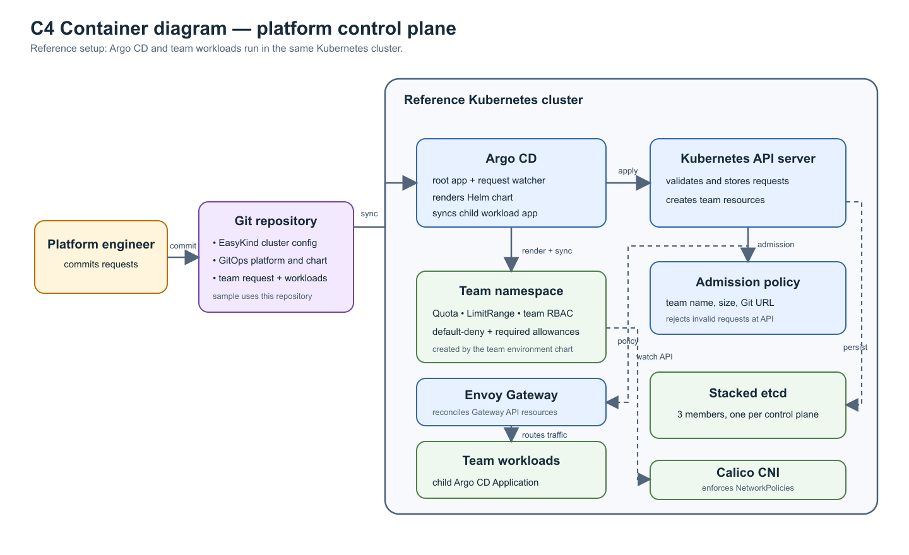
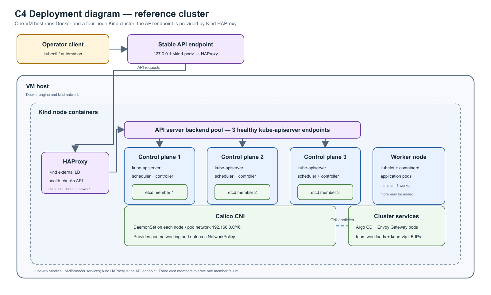

# Architecture diagrams

These diagrams describe the platform control flow and the reference cluster deployment.

## C4 Container diagram

Source: [container-diagram.mmd](container-diagram.mmd)

## C4 Deployment diagram

Source: [deployment-diagram.mmd](deployment-diagram.mmd)

The reference setup runs Argo CD and team workloads in the same cluster. A separate management cluster can use a registered workload cluster as the destination for generated workload Applications.
