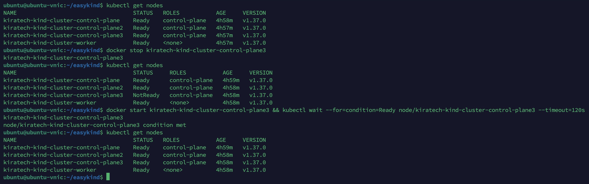
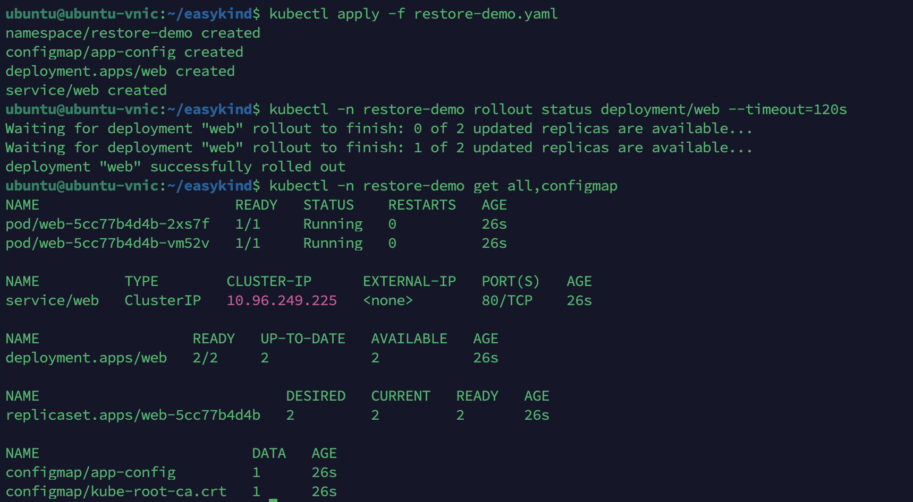
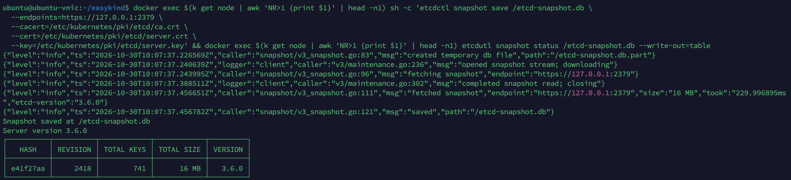
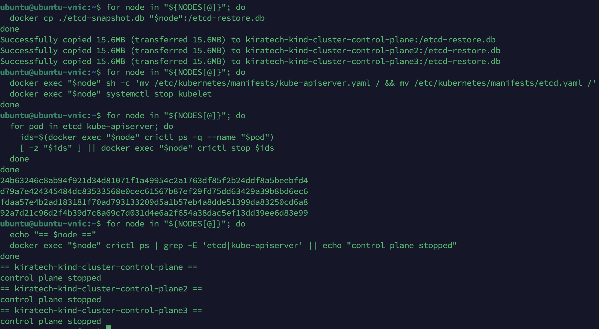
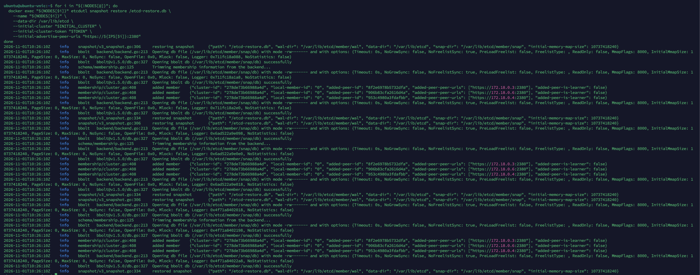
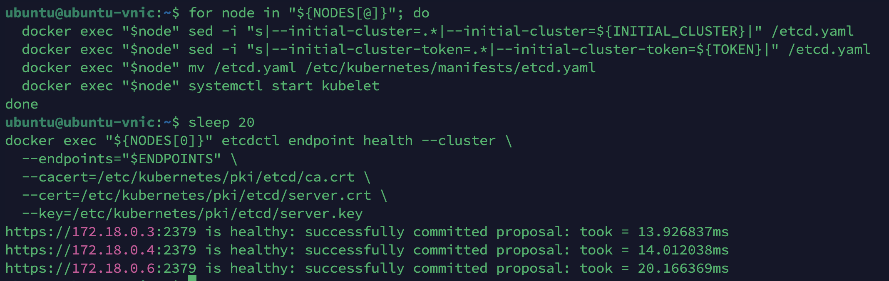
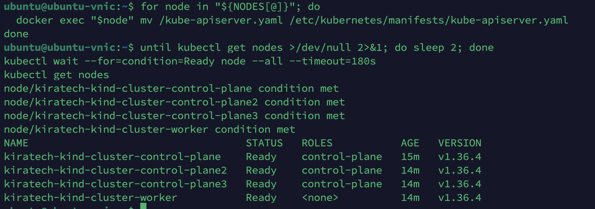
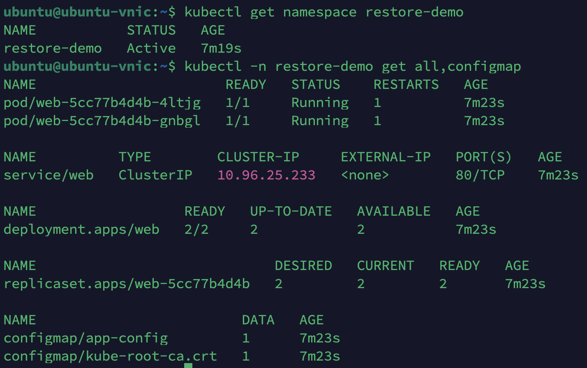
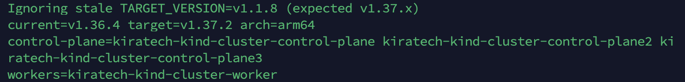
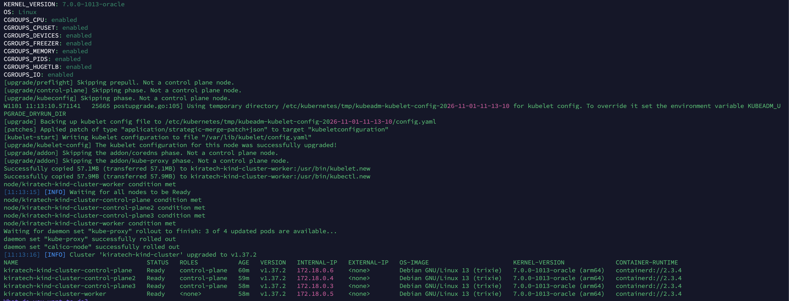

# Part 2 - Operate the control plane

## 2a. Failure tolerance

### Stop one control-plane node and show API still works

In kind, control-plane nodes run as containers. Identify the node names and stop one.

```bash
# List cluster nodes
kubectl get nodes -o wide
```

Example output:
```
NAME                 STATUS   ROLES           AGE   VERSION   INTERNAL-IP   EXTERNAL-IP   OS-IMAGE       KERNEL-VERSION      CONTAINER-RUNTIME
kind-control-plane   Ready    control-plane   10m   v1.33.4   172.18.0.5    <none>        Ubuntu 22.04   6.11.0-26-generic   containerd://1.7.27
kind-control-plane2  Ready    control-plane   10m   v1.33.4   172.18.0.4    <none>        Ubuntu 22.04   6.11.0-26-generic   containerd://1.7.27
kind-control-plane3  Ready    control-plane   10m   v1.33.4   172.18.0.3    <none>        Ubuntu 22.04   6.11.0-26-generic   containerd://1.7.27
kind-worker          Ready    <none>          10m   v1.33.4   172.18.0.6    <none>        Ubuntu 22.04   6.11.0-26-generic   containerd://1.7.27
```

Stop one control-plane node (e.g. `kind-control-plane3`):
```bash
docker stop kind-control-plane3
```

Verify the API server is still reachable and cluster remains functional:
```bash
# API should still respond
kubectl get nodes
kubectl get pods -A | head -10
```

Example output:
```
NAME                 STATUS     ROLES           AGE   VERSION
kind-control-plane   Ready      control-plane   10m   v1.33.4
kind-control-plane2  Ready      control-plane   10m   v1.33.4
kind-control-plane3  NotReady   control-plane   10m   v1.33.4
kind-worker          Ready      <none>          10m   v1.33.4

NAMESPACE            NAME                                         READY   STATUS    RESTARTS   AGE
kube-system          coredns-674b8bbfcf-2jxr8                       1/1     Running   0          10m
kube-system          coredns-674b8bbfcf-x5zvn                       1/1     Running   0          10m
kube-system          etcd-kind-control-plane                       1/1     Running   0          10m
kube-system          etcd-kind-control-plane2                      1/1     Running   0          10m
kube-system          kube-apiserver-kind-control-plane             1/1     Running   0          10m
kube-system          kube-apiserver-kind-control-plane2            1/1     Running   0          10m
kube-system          kube-controller-manager-kind-control-plane   1/1     Running   0          10m
kube-system          kube-controller-manager-kind-control-plane2  1/1     Running   0          10m
kube-system          kube-scheduler-kind-control-plane             1/1     Running   0          10m
kube-system          kube-scheduler-kind-control-plane2            1/1     Running   0          10m
```

The API server remains available (requests go to healthy API server instances behind the load balancer). etcd still has quorum with 2 out of 3 members running (quorum = (n/2)+1 = 2 for n=3). This demonstrates failure tolerance.

Start the node back up:
```bash
docker start kind-control-plane3
# Wait for it to become Ready
kubectl wait --for=condition=Ready node/kind-control-plane3 --timeout=120s
```



### What happens if a second control-plane node is lost?

With stacked etcd on 3 control-plane nodes (3 etcd members), quorum is `floor(3/2)+1 = 2`. 
- Loss of 1 node: 2/3 members remain → quorum is maintained. The API server can still commit writes to etcd; the cluster remains operational (read/write). New control-plane components can still be elected via etcd.
- Loss of 2 nodes: only 1/3 members remain → quorum is lost (need 2). etcd becomes read-only in effect or cannot form consensus; the API server cannot commit changes. `kubectl` operations that require writes will fail. The cluster cannot self-heal (no new leader elections possible, no updates). Recovery requires restoring from an etcd snapshot or bringing back enough members to restore quorum.

Also with the Kubernetes API, if you lose 2 of 3 API server instances, the single remaining API server might still be up, but if etcd has lost quorum, the API server cannot persist state changes. In a multi-API-server setup behind a load balancer, losing API servers reduces capacity but etcd quorum is the critical constraint for write operations.

**Key point:** etcd quorum is the limiting factor. With odd number of etcd members (3), you can tolerate (n-1)/2 failures.

## 2b. Backup and restore

A full etcd restore rewinds the whole cluster to the snapshot. The API is unavailable while the control plane is stopped, and every etcd member must be restored from the same snapshot. Do not use this procedure for a single-node failure; use it when etcd data is lost/corrupted or quorum cannot be recovered.

### Apply the test resources

Apply the manifest with the namespace, ConfigMap, nginx Deployment, and Service:

```bash
kubectl apply -f restore-demo.yaml
kubectl -n restore-demo rollout status deployment/web --timeout=120s
kubectl -n restore-demo get all,configmap
```


### Discover control-plane names and IPs

Kind assigns Docker IPs independently of node order, so resolve each node's `InternalIP` instead of hardcoding them:

```bash
NODES=($(kubectl get nodes --no-headers \
  | awk '$3 ~ /control-plane/ {print $1}'))
CONTROL_PLANE="${NODES[0]}"

IPS=()
for node in "${NODES[@]}"; do
  IPS+=("$(kubectl get node "$node" \
    -o jsonpath='{.status.addresses[?(@.type=="InternalIP")].address}')")
done

for i in "${!NODES[@]}"; do
  printf '%s -> %s\n' "${NODES[$i]}" "${IPS[$i]}"
done
```

### Take and verify a snapshot

etcd replicates data to every member, so one snapshot from any control-plane node contains the full cluster state.

Taking and verifying the snapshot before trusting it:

```bash
docker exec "$CONTROL_PLANE" sh -c 'etcdctl snapshot save /etcd-snapshot.db \
  --endpoints=https://127.0.0.1:2379 \
  --cacert=/etc/kubernetes/pki/etcd/ca.crt \
  --cert=/etc/kubernetes/pki/etcd/server.crt \
  --key=/etc/kubernetes/pki/etcd/server.key' \
&& docker exec "$CONTROL_PLANE" etcdutl snapshot status /etcd-snapshot.db --write-out=table
```



Copy the snapshot off the cluster:

```bash
docker cp "$CONTROL_PLANE":/etcd-snapshot.db ./etcd-snapshot.db
```

### Simulate data loss

```bash
kubectl delete namespace restore-demo
```

### Stop the control plane

Copy the snapshot to all control-plane nodes:

```bash
for node in "${NODES[@]}"; do
  docker cp ./etcd-snapshot.db "$node":/etcd-restore.db
done
```

Move the API server and etcd static pod manifests out of the kubelet directory, then stop kubelet:

```bash
for node in "${NODES[@]}"; do
  docker exec "$node" sh -c 'mv /etc/kubernetes/manifests/kube-apiserver.yaml / && mv /etc/kubernetes/manifests/etcd.yaml /'
  docker exec "$node" systemctl stop kubelet
done
```

Stopping kubelet does not terminate containers that are already running. Stop the remaining etcd and API server containers explicitly:

```bash
for node in "${NODES[@]}"; do
  for pod in etcd kube-apiserver; do
    ids=$(docker exec "$node" crictl ps -q --name "$pod")
    [ -z "$ids" ] || docker exec "$node" crictl stop $ids
  done
done
```

Verify that no etcd or API server containers are running:

```bash
for node in "${NODES[@]}"; do
  echo "== $node =="
  docker exec "$node" crictl ps | grep -E 'etcd|kube-apiserver' || echo "control plane stopped"
done
```



### Restore all etcd members

Build the initial cluster and endpoint lists from the discovered names and IPs:

```bash
TOKEN=kind-etcd-restore

INITIAL_CLUSTER=""
ENDPOINTS=""
for i in "${!NODES[@]}"; do
  INITIAL_CLUSTER+="${NODES[$i]}=https://${IPS[$i]}:2380,"
  ENDPOINTS+="https://${IPS[$i]}:2379,"
done
INITIAL_CLUSTER="${INITIAL_CLUSTER%,}"
ENDPOINTS="${ENDPOINTS%,}"
```

Keep the old data directory until the restore is verified:

```bash
for node in "${NODES[@]}"; do
  docker exec "$node" sh -c 'mv /var/lib/etcd /var/lib/etcd.bak.$(date +%s)'
done
```

Restore every member with its own name and peer URL, but the same initial cluster:

```bash
for i in "${!NODES[@]}"; do
  docker exec "${NODES[$i]}" etcdutl snapshot restore /etcd-restore.db \
    --name "${NODES[$i]}" \
    --data-dir /var/lib/etcd \
    --initial-cluster "$INITIAL_CLUSTER" \
    --initial-cluster-token "$TOKEN" \
    --initial-advertise-peer-urls "https://${IPS[$i]}:2380"
done
```



Verify the restored data directory:

```bash
docker exec "${NODES[0]}" ls /var/lib/etcd/member
```

Example output:
```
snap  wal
```

Patch the etcd manifest with the same initial cluster and token, then start etcd first:

```bash
for node in "${NODES[@]}"; do
  docker exec "$node" sed -i "s|--initial-cluster=.*|--initial-cluster=${INITIAL_CLUSTER}|" /etcd.yaml
  docker exec "$node" sed -i "s|--initial-cluster-token=.*|--initial-cluster-token=${TOKEN}|" /etcd.yaml
  docker exec "$node" mv /etcd.yaml /etc/kubernetes/manifests/etcd.yaml
  docker exec "$node" systemctl start kubelet
done
```

Wait for etcd quorum:

```bash
sleep 20
docker exec "${NODES[0]}" etcdctl endpoint health --cluster \
  --endpoints="$ENDPOINTS" \
  --cacert=/etc/kubernetes/pki/etcd/ca.crt \
  --cert=/etc/kubernetes/pki/etcd/server.crt \
  --key=/etc/kubernetes/pki/etcd/server.key
```

Example output:
```
https://172.18.0.3:2379 is healthy: successfully committed proposal: took = 2.1ms
https://172.18.0.5:2379 is healthy: successfully committed proposal: took = 2.4ms
https://172.18.0.4:2379 is healthy: successfully committed proposal: took = 2.3ms
```



Restore the API server manifests:

```bash
for node in "${NODES[@]}"; do
  docker exec "$node" mv /kube-apiserver.yaml /etc/kubernetes/manifests/kube-apiserver.yaml
done
```

Wait for the API and nodes:

```bash
until kubectl get nodes >/dev/null 2>&1; do sleep 2; done
kubectl wait --for=condition=Ready node --all --timeout=180s
kubectl get nodes
```

Example output:
```
NAME                                   STATUS   ROLES           AGE   VERSION
kiratech-kind-cluster-control-plane    Ready    control-plane   18m   v1.33.4
kiratech-kind-cluster-control-plane2   Ready    control-plane   18m   v1.33.4
kiratech-kind-cluster-control-plane3   Ready    control-plane   18m   v1.33.4
kiratech-kind-cluster-worker           Ready    <none>          18m   v1.33.4
```



### Verify the restore

```bash
kubectl get namespace restore-demo
kubectl -n restore-demo get all,configmap
```


Check that the restored etcd members are healthy:

```bash
docker exec "${NODES[0]}" etcdctl endpoint health --cluster \
  --endpoints="$ENDPOINTS" \
  --cacert=/etc/kubernetes/pki/etcd/ca.crt \
  --cert=/etc/kubernetes/pki/etcd/server.crt \
  --key=/etc/kubernetes/pki/etcd/server.key
```

After verification, remove the old data directories:

```bash
for node in "${NODES[@]}"; do
  docker exec "$node" sh -c 'rm -rf /var/lib/etcd.bak.*'
done
```

### What is and is not restored

- Restored: every Kubernetes object stored in etcd at snapshot time (namespaces, Deployments, Services, ConfigMaps, Secrets, RBAC, CRDs, NetworkPolicies).
- Not restored: changes made after the snapshot, PersistentVolume data, container images, external DNS/load balancers, and anything stored outside etcd.
- The restore is all-or-nothing. You cannot restore a single namespace from an etcd snapshot; use Velero for namespace-level restores.
- Never restore only one member of a multi-member etcd cluster. All members must use the same snapshot and the same initial cluster, or they will not form a consistent cluster.

Production notes:
- Take snapshots on a schedule (for example every 6 hours), verify them with `etcdutl snapshot status`, copy them off-cluster, and test restores regularly.
- The recoverable point is the snapshot; the time to restore is the RTO. Size retention and frequency from the required RPO.
- Keep the etcd client tools compatible with the etcd server version used by the cluster.

## 2c. Upgrade

Upgrade the cluster by one minor version of Kubernetes without interrupting a sample workload (e.g. an nginx Deployment with 2 replicas probed every second). Describe the order of operations and the version skew rules.

### Upgrade method: EasyKind `upgrade_cluster`

The upgrade was performed with the `upgrade_cluster` method from [my EasyKind repo](https://github.com/nico-1512/easykind), not by recreating the kind cluster. From the EasyKind checkout:

```bash
./scripts/upgrade_cluster
```

Enter the cluster name, accept the default target (`v1.37.2`, the latest patch of the next minor), and confirm. EasyKind discovers the nodes, downloads and checksum-verifies the target `kubeadm`, `kubelet` and `kubectl` binaries, upgrades the first control-plane node, then the remaining control-plane nodes and workers, restarts kubelet, and verifies nodes and add-ons. For kind it passes `--ignore-preflight-errors=SystemVerification`; with the single worker it does not drain the worker, so both nginx replicas keep serving.

The commands in the rest of this section are the equivalent manual steps, kept for auditability and for running the procedure outside EasyKind.

### Manual equivalent: set the target version and discover the nodes

Upgrade exactly one minor version at a time. The target is the latest patch of the next minor release; set `TARGET_VERSION` before running the commands to pin a different patch.

```bash
CURRENT_VERSION="$(kubectl get --raw /version \
  | sed -n 's/.*"gitVersion"[[:space:]]*:[[:space:]]*"\([^"]*\)".*/\1/p')"
CURRENT_MINOR="${CURRENT_VERSION#v1.}"; CURRENT_MINOR="${CURRENT_MINOR%%.*}"
TARGET_MINOR="$((CURRENT_MINOR + 1))"
if [[ -n "${TARGET_VERSION:-}" && "$TARGET_VERSION" != v1."${TARGET_MINOR}".* ]]; then
  echo "Ignoring stale TARGET_VERSION=$TARGET_VERSION (expected v1.${TARGET_MINOR}.x)" >&2
  unset TARGET_VERSION
fi
TARGET_VERSION="${TARGET_VERSION:-$(curl -fsSL "https://dl.k8s.io/release/stable-1.${TARGET_MINOR}.txt")}"

if [[ -z "$TARGET_VERSION" ]]; then
  echo "No stable-1.${TARGET_MINOR} release found; set TARGET_VERSION to an existing release before continuing." >&2
fi

NODES=($(kubectl get nodes --no-headers | awk '$3 ~ /control-plane/ {print $1}'))
WORKERS=($(kubectl get nodes --no-headers | awk '$3 !~ /control-plane/ {print $1}'))
FIRST_CP="${NODES[0]}"

case "$(uname -m)" in
  x86_64|amd64) ARCH=amd64 ;;
  aarch64|arm64) ARCH=arm64 ;;
  *) echo "Unsupported architecture: $(uname -m)" >&2; exit 1 ;;
esac

printf 'current=%s target=%s arch=%s\n' "$CURRENT_VERSION" "$TARGET_VERSION" "$ARCH"
printf 'control-plane=%s\nworkers=%s\n' "${NODES[*]}" "${WORKERS[*]}"
```

Example output:
```
current=v1.36.4 target=v1.37.2 arch=arm64
control-plane=kiratech-kind-cluster-control-plane kiratech-kind-cluster-control-plane2 kiratech-kind-cluster-control-plane3
workers=kiratech-kind-cluster-worker
```



### Setup sample workload with probes
```bash
kubectl create deployment nginx --image=nginx:1.25 --replicas=2
kubectl expose deployment nginx --port=80
kubectl patch deployment nginx --type=strategic -p '{
  "spec": {
    "template": {
      "spec": {
        "containers": [
          {
            "name": "nginx",
            "readinessProbe": {
              "httpGet": { "path": "/", "port": 80 },
              "initialDelaySeconds": 5,
              "periodSeconds": 1
            },
            "livenessProbe": {
              "httpGet": { "path": "/", "port": 80 },
              "initialDelaySeconds": 5,
              "periodSeconds": 1
            }
          }
        ]
      }
    }
  }
}'

# Verify pods running
kubectl get pods -l app=nginx -o wide
```

Start a continuous probe inside the cluster. On kind the Service ClusterIP is not routable from the VM host, so run the client in a pod. It is pinned to a control-plane node because those nodes are not drained during this procedure.

```bash
kubectl apply -f - <<'EOF'
apiVersion: apps/v1
kind: Deployment
metadata:
  name: nginx-probe
spec:
  replicas: 1
  selector:
    matchLabels:
      app: nginx-probe
  template:
    metadata:
      labels:
        app: nginx-probe
    spec:
      nodeSelector:
        node-role.kubernetes.io/control-plane: ""
      tolerations:
        - key: node-role.kubernetes.io/control-plane
          operator: Exists
          effect: NoSchedule
      containers:
        - name: curl
          image: curlimages/curl:8.10.1
          command:
            - sh
            - -c
            - 'while true; do curl -s -o /dev/null -w "%{http_code} %{time_total}\n" http://nginx.default.svc.cluster.local/; sleep 1; done'
EOF

kubectl rollout status deployment/nginx-probe --timeout=120s
kubectl logs -f deployment/nginx-probe
```

Keep the log command running in a second terminal. Every line should start with `200`, including while the control-plane and worker nodes are upgraded.

### Upgrade order (kubeadm-style, applicable to managed control plane)

For a cluster with 3 control-plane nodes + workers, follow the upgrade order:

1. **Upgrade kubeadm on all control-plane nodes first** (one by one)
2. **Upgrade the first control-plane node:**
   - `kubeadm upgrade plan` to verify
   - `kubeadm upgrade apply v1.XX.Y` on the first CP node
   - upgrade kubelet and kubectl on that node, restart kubelet
3. **Upgrade remaining control-plane nodes** (one at a time): `kubeadm upgrade node`, upgrade kubelet/kubectl, restart
4. **Upgrade worker nodes** (one by one): drain (if there is another worker), `kubeadm upgrade node`, upgrade kubelet/kubectl, restart, uncordon
5. **Verify cluster health** and that the probe recorded only `200` responses

### Download the target Kubernetes binaries

Kind nodes run containers without the Kubernetes package repository, so copy the release binaries into the nodes instead of using `apt`.

```bash
if [[ -z "${TARGET_VERSION:-}" || -z "${ARCH:-}" ]]; then
  echo "TARGET_VERSION/ARCH are empty: run the 'Set the target version and discover the nodes' block in this same shell first." >&2
else
  TMPDIR="$(mktemp -d)"
  for bin in kubeadm kubelet kubectl; do
    curl -fsSL -o "${TMPDIR}/${bin}" \
      "https://dl.k8s.io/release/${TARGET_VERSION}/bin/linux/${ARCH}/${bin}"
    curl -fsSL -o "${TMPDIR}/${bin}.sha256" \
      "https://dl.k8s.io/release/${TARGET_VERSION}/bin/linux/${ARCH}/${bin}.sha256"
    expected="$(cat "${TMPDIR}/${bin}.sha256")"
    actual="$(sha256sum "${TMPDIR}/${bin}" | awk '{print $1}')"
    [[ "$actual" == "$expected" ]] || { echo "Checksum verification failed for $bin" >&2; break; }
    chmod +x "${TMPDIR}/${bin}"
  done
fi

install_binary() {
  local node="$1" bin="$2"
  docker cp "${TMPDIR}/${bin}" "${node}:/usr/bin/${bin}.new"
  docker exec "$node" sh -c "chmod +x /usr/bin/${bin}.new && mv /usr/bin/${bin}.new /usr/bin/${bin}"
}

wait_for_node() {
  local node="$1"
  until kubectl get node "$node" -o jsonpath='{.status.nodeInfo.kubeletVersion}' 2>/dev/null \
    | grep -q "^${TARGET_VERSION}"; do
    sleep 2
  done
  kubectl wait --for=condition=Ready "node/${node}" --timeout=180s
}
```

### Upgrade the first control-plane node

Install the new kubeadm on all control-plane nodes, then upgrade the first one. `kubeadm upgrade apply` upgrades the static control-plane pods and renews certificates; kind's HAProxy keeps sending API traffic to the other two control-plane nodes.

Kind node containers cannot load the VM kernel's `configs` module, so kubeadm's `SystemVerification` preflight check fails. Pass `--ignore-preflight-errors=SystemVerification` for kind nodes; the rest of the preflight checks still run.

```bash
for node in "${NODES[@]}"; do
  install_binary "$node" kubeadm
  docker exec "$node" kubeadm version
done

for node in "${NODES[@]}"; do
  docker exec "$node" kubeadm config images pull --kubernetes-version "$TARGET_VERSION"
done

docker exec "$FIRST_CP" kubeadm upgrade plan
docker exec "$FIRST_CP" kubeadm upgrade apply -y "$TARGET_VERSION" \
  --ignore-preflight-errors=SystemVerification

install_binary "$FIRST_CP" kubelet
install_binary "$FIRST_CP" kubectl
docker exec "$FIRST_CP" sh -c 'systemctl daemon-reload && systemctl restart kubelet'
wait_for_node "$FIRST_CP"
```

Example output:
```
[upgrade/successful] SUCCESS! Your cluster was upgraded to "v1.37.2". Enjoy!
[upgrade/kubelet] Now that your control plane is upgraded, please proceed with upgrading your kubelets if you haven't already done so.
```

### Upgrade the remaining control-plane nodes

Upgrade one node at a time and wait for it to be Ready on the target kubelet version before continuing. The API remains available because the other control-plane nodes stay in the HAProxy backend pool.

```bash
for node in "${NODES[@]:1}"; do
  docker exec "$node" kubeadm upgrade node --ignore-preflight-errors=SystemVerification
  install_binary "$node" kubelet
  install_binary "$node" kubectl
  docker exec "$node" sh -c 'systemctl daemon-reload && systemctl restart kubelet'
  wait_for_node "$node"
done
```

### Upgrade the worker nodes

On a single-worker cluster, do not drain the worker: both nginx replicas live there and there is nowhere to reschedule them. Restarting kubelet does not stop the running containers, so traffic keeps flowing. With two or more workers, create a PodDisruptionBudget and drain one worker at a time so the remaining replica keeps serving.

```bash
if (( ${#WORKERS[@]} >= 2 )); then
  kubectl create poddisruptionbudget nginx-pdb --selector=app=nginx --min-available=1 \
    --dry-run=client -o yaml | kubectl apply -f -
fi

for node in "${WORKERS[@]}"; do
  if (( ${#WORKERS[@]} >= 2 )); then
    kubectl drain "$node" --ignore-daemonsets --delete-emptydir-data
  else
    echo "Single worker: keeping $node schedulable so the nginx pods stay running"
  fi

  install_binary "$node" kubeadm
  docker exec "$node" kubeadm upgrade node --ignore-preflight-errors=SystemVerification

  install_binary "$node" kubelet
  install_binary "$node" kubectl
  docker exec "$node" sh -c 'systemctl daemon-reload && systemctl restart kubelet'

  if (( ${#WORKERS[@]} >= 2 )); then
    kubectl uncordon "$node"
  fi
  wait_for_node "$node"
done
```

### Verify the upgrade

```bash
kubectl get nodes -o wide
kubectl version
kubectl -n kube-system rollout status daemonset/kube-proxy --timeout=180s
kubectl -n kube-system rollout status daemonset/calico-node --timeout=300s
kubectl -n kube-system rollout status deployment/calico-kube-controllers --timeout=180s
kubectl get pods -l app=nginx -o wide
kubectl get endpoints nginx
```

Example output:
```
NAME                                   STATUS   ROLES           AGE   VERSION
kiratech-kind-cluster-control-plane    Ready    control-plane   42m   v1.37.2
kiratech-kind-cluster-control-plane2   Ready    control-plane   42m   v1.37.2
kiratech-kind-cluster-control-plane3   Ready    control-plane   42m   v1.37.2
kiratech-kind-cluster-worker           Ready    <none>          42m   v1.37.2
```



### Version skew rules (important)
- kube-apiserver instances must be within one minor version of each other
- kube-controller-manager, kube-scheduler and cloud-controller-manager must not be newer than kube-apiserver, and can be up to one minor version older
- kubelet and kube-proxy must not be newer than kube-apiserver; kubelet can be up to three minor versions older
- kubectl can be one minor version older or newer than kube-apiserver
- Kubernetes minor versions cannot be skipped: upgrade one minor at a time (for example 1.36 -> 1.37), never 1.36 -> 1.38
- etcd version compatibility must be respected (check the Kubernetes release notes)

### Difference on real VMs

On a real kubeadm cluster the same order is used, but kubeadm/kubelet/kubectl are upgraded with the OS package manager. Example on Debian/Ubuntu:

```bash
# On every control-plane node: upgrade kubeadm first
sudo apt-mark unhold kubeadm
sudo apt-get update
sudo apt-get install -y kubeadm='1.37.x-*'
sudo apt-mark hold kubeadm

# First control-plane node
sudo kubeadm upgrade plan
sudo kubeadm upgrade apply v1.37.x
sudo apt-mark unhold kubelet kubectl
sudo apt-get install -y kubelet='1.37.x-*' kubectl='1.37.x-*'
sudo apt-mark hold kubelet kubectl
sudo systemctl daemon-reload && sudo systemctl restart kubelet

# Remaining control-plane nodes and workers, one at a time
kubectl drain <node> --ignore-daemonsets --delete-emptydir-data
sudo apt-mark unhold kubeadm kubelet kubectl
sudo apt-get install -y kubeadm='1.37.x-*' kubelet='1.37.x-*' kubectl='1.37.x-*'
sudo kubeadm upgrade node
sudo systemctl daemon-reload && sudo systemctl restart kubelet
kubectl uncordon <node>
```

Kind nodes are containers created from a node image. Recreating the cluster with a newer `kindest/node` image is the supported kind path, but it replaces the nodes and interrupts workloads. The in-place procedure above upgrades the existing nodes without recreating the cluster. It is not the standard kind workflow, so take and verify an etcd snapshot first (Part 2b) and keep the old data directory until the upgrade is verified.


### Key considerations to avoid interruption
- Use multiple replicas of workloads (>=2) so rolling updates/drain operations don't take all pods down
- Use PodDisruptionBudgets if needed
- With a single worker, upgrade kubelet without draining; with several workers, drain one node at a time
- Uncordon after upgrades complete
- Upgrade one node at a time
- Ensure cluster has spare capacity or replicas are spread across nodes
- Health checks/probes detect when pods are ready before sending traffic

## 2d. GitOps with Argo CD

Argo CD is installed by EasyKind, and this repository is the source of truth for the workloads that Argo CD manages. The bootstrap layer stays with EasyKind: kind, Calico, kube-vip bootstrap, Argo CD itself, node binaries, Kubernetes upgrades and etcd backup/restore. Post-bootstrap add-ons such as Envoy Gateway, Gateway API routes and other Helm/Kustomize components can be moved to Argo CD later as dedicated Applications.

### Register the repository and create the Applications

From the EasyKind checkout:

```bash
./scripts/install_argocd
./scripts/configure_gitops
```

`configure_gitops` asks for the cluster name, Git URL, branch, authentication method and repository path. The path defaults to the repository root (`.`). There is no default repository URL. For this repository use:

- URL: `https://github.com/nico-1512/kiratech-challenge.git`
- Branch: `main`
- Path: `.` for the whole repository, or a subdirectory such as `gitops/apps/restore-demo`, `gitops/apps/nginx-probe` or `gitops/platform/external-secrets`

The script registers an Argo CD repository Secret and creates one Argo `Application` for the chosen path. The Application name is derived from the repository name and the path basename, and the destination namespace defaults to `default`. The Application uses automated sync with `prune: false` and `selfHeal: true`, so existing objects are adopted and updated but never deleted by Argo CD. `CreateNamespace=true` allows Argo CD to create the target namespace when it does not exist.

### Private repository authentication

The script offers three authentication modes:

- **Public**: no credentials are stored.
- **Private HTTPS**: enter a Git username and a token with read access to the repository. The script stores them as the Argo CD Secret `username` and `password` fields.
- **Private SSH**: enter an SSH URL such as `git@github.com:owner/repo.git` and the path to the private key. The script stores `sshPrivateKey`. GitHub/GitLab SSH host keys are already trusted by Argo CD.

For GitHub HTTPS, create a fine-grained personal access token with **Contents: Read-only** permission for the repository. Use your GitHub username (or `x-access-token`) as the username and the token as the password. For SSH, add the matching public key as a deploy key with read access.

For a self-hosted SSH server, add its host key to Argo CD's `argocd-ssh-known-hosts-cm` ConfigMap or use the Argo CD UI under **Settings → Certificates**. The host key must be unhashed `known_hosts` data, for example from `ssh-keyscan git.example.com`.

The credentials live in an Argo CD repository Secret in the `argocd` namespace, not in this repository:

```bash
kubectl -n argocd get secret repo-<name> -o yaml
```

Any path in the repository can be managed. Pointing at `.` makes the selected repository root the Argo source; pointing at a subdirectory scopes the Application to that component. Envoy Gateway, Gateway API routes and other Helm/Kustomize add-ons can be added as separate Argo `Application` resources.

| Managed by Argo CD now | Can be moved to Argo CD later | Kept in the EasyKind bootstrap |
| --- | --- | --- |
| `gitops/apps/restore-demo` | Envoy Gateway (Helm) | kind cluster creation |
| `gitops/apps/nginx-probe` | Gateway API routes | Calico CNI |
| `gitops/platform/external-secrets` | Other Helm/Kustomize add-ons | kube-vip bootstrap |
| `.` (whole repository) | | Argo CD itself |
| | | etcdctl/etcdutl and Kubernetes upgrades |
| | | etcd snapshot/restore |

### Verify the connection

```bash
kubectl -n argocd get applications
kubectl -n argocd get application <application-name> \
  -o jsonpath='{.status.sync.status} {.status.health.status}{"\n"}'
```

Use the name shown by `get applications`; for example, a root Application for this repository is named `kiratech-challenge`, while `gitops/apps/nginx-probe` becomes `kiratech-challenge-nginx-probe`.

The repository must exist and be public before Argo CD can clone it. If an Application reports `ComparisonError` or `Unknown`, check the repository URL/branch and the Application events:

```bash
kubectl -n argocd describe application <application-name>
```

### Open the UI

```bash
kubectl -n argocd port-forward svc/argocd-server 8080:443
```

Then open `https://localhost:8080` and log in as `admin`. Read the generated password with:

```bash
kubectl -n argocd get secret argocd-initial-admin-secret \
  -o jsonpath='{.data.password}' | base64 -d
```

### Add another workload

1. Add a directory under `gitops/apps/` with a `kustomization.yaml` and its resources.
2. Push the change.
3. Run `./scripts/configure_gitops` again and enter the new path, such as `gitops/apps/my-app`. To manage the whole repository from one Application, enter `.` instead.
