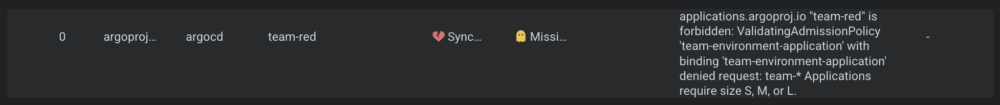

# Part 3 - Build the platform control plane

This document describes the first self-service capability on the reference cluster from Part 1. It uses Argo CD and Kubernetes admission policy to create a team environment from one declarative request.

## 3a. Design

The request is an Argo CD `Application` resource stored under `gitops/team-requests/`. An Argo CD Application watches that directory and applies each request to the `argocd` namespace. Adding one request file to Git is enough to ask for an environment.

A Kubernetes `ValidatingAdmissionPolicy` checks requests whose Application name starts with `team-`. It requires a DNS-label team name matching the Application name, a size of `S`, `M` or `L`, and a valid HTTPS or SSH Git URL. An optional repository-relative `teamPath` is checked as well. Invalid requests are rejected by the API server when Argo CD applies them. The Helm chart has a `values.schema.json` for another validation check when it is rendered.

The request Application renders the chart at `gitops/platform/team-environments`. The chart creates:

- A namespace named `team-<teamName>`
- A ResourceQuota and LimitRange based on the requested size
- A namespaced developer Role and a RoleBinding for group `team:<teamName>`
- A default-deny ingress and egress policy
- A policy allowing pod-to-pod traffic within the team namespace and DNS queries to CoreDNS
- A child Argo CD Application that deploys the team's workload repository

The namespace policy allows the included sample `api` workload to resolve `db` with DNS and reach its HTTP service. Other cross-namespace traffic remains denied. Teams that need another flow must request and document that flow before it is added to the environment template.

| Size | CPU requests | Memory requests | CPU limits | Memory limits | Pods | PVCs |
| --- | ---: | ---: | ---: | ---: | ---: | ---: |
| S | 2 | 4 Gi | 4 | 8 Gi | 20 | 5 |
| M | 4 | 8 Gi | 8 | 16 Gi | 40 | 10 |
| L | 8 | 16 Gi | 16 | 32 Gi | 80 | 20 |

The example request is [team-blue.yaml](../../gitops/team-requests/team-blue.yaml). Its workload repository path is [team-workloads/blue](../../gitops/team-workloads/blue/kustomization.yaml).

For the short provisioning steps, see [Provision a team](provision-a-team.md).

## 3b. Enable the control plane

The cluster needs Argo CD and Calico, which enforces Kubernetes NetworkPolicies. Configure the root Argo CD Application to track this repository's `gitops/` path. The root Kustomization includes `platform/team-environments`, which installs the admission policy and the Application that watches team requests.

Use the cluster context for all commands below:

```bash
kubectl -n argocd get applications
kubectl get validatingadmissionpolicy team-environment-application
kubectl get validatingadmissionpolicybinding team-environment-application
```

Wait until `platform-team-requests` is Synced and Healthy before adding a team request. The repository must be reachable by Argo CD, and any repository credentials must already be configured in Argo CD.

## 3c. Request an environment

For a real team, create one Application manifest under `gitops/team-requests/` using this template:

```yaml
apiVersion: argoproj.io/v1alpha1
kind: Application
metadata:
  name: team-blue
  namespace: argocd
  finalizers:
    - resources-finalizer.argocd.argoproj.io
spec:
  project: default
  source:
    repoURL: https://github.com/nico-1512/kiratech-challenge.git
    targetRevision: main
    path: gitops/platform/team-environments
    helm:
      valuesObject:
        teamName: blue
        size: S
        teamRepository: https://github.com/nico-1512/kiratech-challenge.git
        teamPath: gitops/team-workloads/blue
  destination:
    server: https://kubernetes.default.svc
    namespace: argocd
  syncPolicy:
    automated:
      prune: true
      selfHeal: true
```

Once created, the request Application renders the team environment and its child workload Application.

## 3d. Check API validation

Make a temporary copy of a request and change its size to an unsupported value. Server-side dry-run sends the request to API admission without saving it:

```bash
sed 's/size: S/size: XL/' gitops/team-requests/team-blue.yaml > /tmp/team-blue-invalid.yaml
kubectl apply --dry-run=server -f /tmp/team-blue-invalid.yaml
```

The API server should reject it with the policy message that the size must be `S`, `M` or `L`. Missing or invalid team names and repository URLs are rejected in the same way.

The screenshot shows Argo CD reporting the rejected `team-red` request and the admission policy's size validation message:



## 3e. Delete an environment

Delete the request file from Git and commit the change. The directory Application prunes the request Application. Its Argo CD resources finalizer deletes the child workload Application and the chart-managed namespace resources, including the namespace.

```bash
kubectl -n argocd get applications
kubectl get namespace team-blue
```

The namespace should be absent after deletion has completed. If a request is removed only with `kubectl delete` while its file remains in Git, Argo CD will recreate it; remove the request from Git to make deletion persistent.
